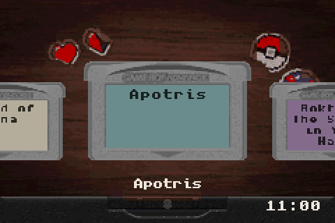
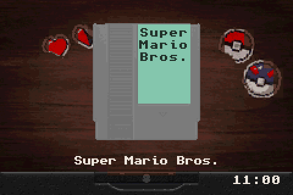

# EverFront

A themeable game shelf for the **EverDrive GBA Pro**. EverFront runs from the SD card as a normal `.gba` file and boots your games with their saves, clock, sensors and the L+R in-game menu. It has two themes, **Slot** and **Shelf**. Besides GBA games it has shelves for **Game Boy, Game Boy Color, NES, Master System and Game Gear**, which run through emulators you supply.

| Slot theme | Shelf theme |
| --- | --- |
|  |  |
|  |  |

*Shown with plain labels. With your own label packs, each cart shows its real label (see [Label art](docs/labels.md)).*

**[Download the latest release](../../releases/latest)** · [Changelog](CHANGELOG.md) · [Label art](docs/labels.md) · [Building from source](docs/building.md)

There is also an early test build for the **EverDrive GBA X5 Mini** (GBA games only, saves off for now). It's in each release as `everfront-mini-<version>.zip`.

## What you need

| Item | Requirement |
| --- | --- |
| Cart | An EverDrive GBA Pro. The X5 Mini has its own test build (see above). |
| Firmware | 26.0127 for the L+R in-game menu. Other versions still launch games, but the in-game menu stays off. Tested on 26.0127 only. |
| SD card | Already set up for the EverDrive (the `edgba` folder from krikzz's firmware is on it). |
| Games | Unzipped `.gba` files in a folder named `Game Boy Advance` or `GBA` at the card's root (or at the root itself). Up to 3000 games; subfolders are not searched. |
| Other systems (optional) | An emulator per system in `edgba/edapp/<system>/`, plus a games folder for it (see [Other systems](#other-systems)). |

To check the firmware, open the EverDrive menu and look at Device Info.

## Install

1. Download `everfront-<version>.zip` from the [latest release](../../releases/latest).
2. Put the EverDrive's SD card in your computer.
3. Unzip the release and copy the `everfront` folder from its `SD card` folder to the root of the card, next to `edgba`.
4. Make sure your games are in `Game Boy Advance` or `GBA` at the root of the card.
5. Optional: add emulators and games for other systems ([Other systems](#other-systems)) and your label packs ([Label art](docs/labels.md)).
6. Put the card back in the cart and switch on.
7. In the EverDrive menu, open `everfront`, select `everfront.gba` and press A:
   - **Start Game** starts EverFront this once.
   - **Start Mode-A** starts it now and straight away at every power-up.

To update, copy the new `everfront` folder over the old one. Saves, favourites and settings are kept.

## Using it

| Button | What it does |
| --- | --- |
| Left / Right | One cart along; hold to scroll faster. The shelf wraps from the last game to the first. |
| L / R | Five carts along |
| Up / Down | Next or previous shelf: GBA, Game Boy, Game Boy Color, NES, Master System, Game Gear (only those with games and an emulator) |
| A | Put the cart in the slot and start the game |
| SELECT | Add the game to your favourites or take it off (favourites are marked with a `*`) |
| START | Settings: Theme, Show (all games, favourites or recently played), Clock on or off, Show log, Close |
| B | Back to the shelf after an error message, or close the log or Settings |
| L + R in a GBA game | The EverDrive's in-game menu: save and load states, reset, exit |

Saves work exactly as with the EverDrive menu: they live in `edgba/gamedata`, so a game started from either menu sees the same save. Exit Game in the in-game menu returns to the EverDrive menu, not to EverFront. Boktai's solar sensor and tilt or gyro games (Yoshi Topsy-Turvy, WarioWare Twisted) use the cart's own sensors, as they do from the EverDrive menu.

## Other systems

EverFront includes no emulators. Each system uses the emulator the EverDrive menu would use, one `.gba` per folder (or one named `app.gba`). An optional `config.txt` beside it is read as the EverDrive menu reads it.

| System | Emulator folder | Example emulator | Games folder | Files |
| --- | --- | --- | --- | --- |
| Game Boy | `edgba/edapp/gb/` | Goomba | `Game Boy` or `GB` | `.gb` |
| Game Boy Color | `edgba/edapp/gbc/` | Goomba Color | `Game Boy Color` or `GBC` | `.gbc` and `.gb` |
| NES | `edgba/edapp/nes/` | PocketNES | `NES` or `Nintendo` | `.nes` |
| Master System | `edgba/edapp/sms/` | SMSAdvance | `Master System` or `SMS` | `.sms` |
| Game Gear | `edgba/edapp/gg/` | SMSAdvance | `Game Gear` or `GG` | `.gg` |

A shelf appears when its system has both an emulator and games. In these games L+R opens the emulator's own menu, not the EverDrive's. Its Exit restarts the game, so you leave an emulated game by switching off.

> [!IMPORTANT]
> **Saving in emulated games:** the emulators only write a game's save to the cart when you open their menu (L+R) or use Exit there. Before you switch off, press L+R so the save is written, then power off. Switching straight off loses what you saved since.

## Label art

Without label packs, every cart shows a plain coloured label with the game's name. Label packs are built on a computer from your own label scans. They're the publishers' artwork, so none are included. See **[docs/labels.md](docs/labels.md)** for the steps, every system's pack names and sizes, and options for matching renamed roms.

## Known limits

- **Exit Game** goes back to the EverDrive menu, not to the shelf.
- **Emulated games** have no EverDrive in-game menu (the emulator's menu replaces it), and you leave them by switching off. Open their menu first so the save is written.
- **Cheats** are not supported.
- **Games:** one folder per system, no zips.
- **Firmware:** the in-game menu needs firmware 26.0127. A firmware update may turn it off until EverFront is updated too.

## Troubleshooting

| What you see | What to do |
| --- | --- |
| "Theme file missing" | `themes/slot.thm` is not in `everfront/themes`. Copy the `themes` folder from the zip again. |
| "Theme file: wrong format" or another "Theme…" message | The theme file is damaged or from a different version. Copy it again from the same zip as the `.gba`. |
| "NO GAMES FOUND" | No games in `Game Boy Advance`, `GBA` or the root. Check the folder name and that the games are unzipped. |
| A system's shelf is missing | Its emulator isn't in `edgba/edapp/<system>/`, or its games folder is empty or named differently. |
| Plain coloured labels | No label pack for this theme and system, or the scans' names don't match the roms. Rebuild the pack, with `--alias` for renamed roms. |
| An emulated game lost its progress | It was switched off without opening the emulator's menu first (see [Other systems](#other-systems)). |
| A game won't start, or an error after A | Press B to get back. Try the game from the EverDrive menu to rule out the rom itself. |
| L+R does nothing in a GBA game | The firmware isn't 26.0127, so the in-game menu is off. |

EverFront writes a log to `everfront/log.txt` on the card. Please attach it to any [issue](../../issues) you open.

## Credits

- **EverFront** by Nelynes, under the [GNU GPL v3.0](LICENSE).
- **Slot theme art** from [Slot](https://github.com/BrandonKowalski/slot) by Brandon Kowalski, with art by [Markus](https://github.com/MarkusMaribu), via [slotPlus](https://github.com/nelynes/slotPlus) (GPL-3.0). Used with their blessing.
- **NES, Master System and Game Gear cart art** (Slot theme) by Nelynes.
- **EverDrive drivers** by krikzz ([gba-pro-pub](https://github.com/krikzz/gba-pro-pub), [gba-ed-pub](https://github.com/krikzz/gba-ed-pub)), MIT. krikzz has given the project his blessing; EverFront is not made or supported by him.
- **FatFs** by ChaN (Mini build). **Unscii 8** font by viznut, public domain.

EverFront contains none of the EverDrive menu's code. It starts games the same way the stock menu does, and it reads the in-game menu from the cart's own firmware at run time. Full credits are in [NOTICE.txt](NOTICE.txt).
