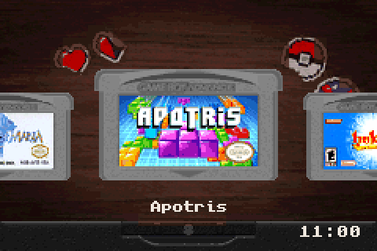
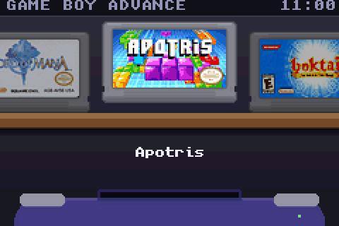
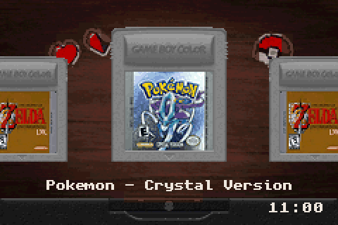
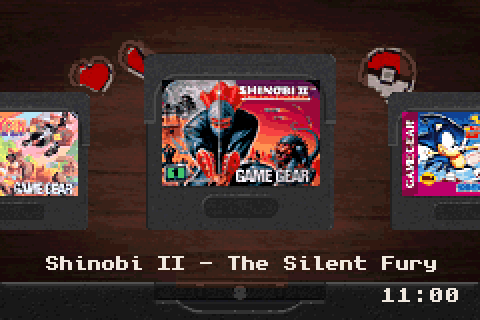
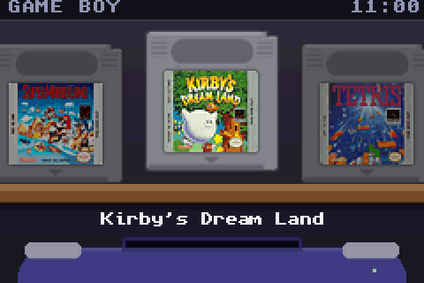
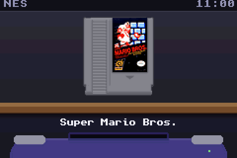
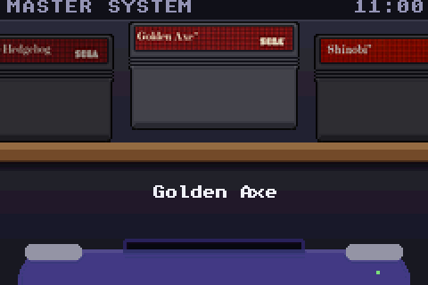

<h1 align="center">EverFront</h1>

  <strong>Your game collection, back on the shelf.</strong> 
  A beautiful, themeable game library for the EverDrive GBA Pro.

  

  <a href="../../releases/latest"><strong>Download</strong></a> ·
  <a href="GUIDE.md"><strong>User guide</strong></a> ·
  <a href="CHANGELOG.md">What's new</a>

---

EverFront replaces the EverDrive's list of file names with something that feels like owning the games. Flick through your carts, see their labels, pick one, and watch it drop into the console. Then play, with everything working the way it always has.

## Two themes, one collection

| **Slot** | **Shelf** |
| :---: | :---: |
|  |  |
| Detailed carts on warm wood, based on the much-loved [Slot](https://github.com/BrandonKowalski/slot) front end. | A clean, flat-shaded shelf with a console waiting underneath. |

Switch between them any time from the settings menu.

## More than Game Boy Advance

Add an emulator and EverFront gives each system its own shelf, with its own carts. Press Up or Down to move between them.

| | | |
| :---: | :---: | :---: |
|  |  |  |
| **Game Boy Color** | **NES** | **Game Gear** |
|  |  |  |
| **Game Boy** | **NES** (Shelf theme) | **Master System** |

> [!NOTE]
> **About the labels in these pictures:** EverFront doesn't come with label art or emulators. You add labels from your own scans with the included tool, and until you do, each cart shows a tidy plain label with the game's name. The [user guide](GUIDE.md#label-art) walks you through it.

## What you get

- 🎮 **Your games as carts.** Real cart shapes for every system, with your own label art on them.
- 🎨 **Two themes.** Slot and Shelf, switchable in seconds.
- 📚 **Six systems.** Game Boy Advance, Game Boy, Game Boy Color, NES, Master System and Game Gear.
- ⭐ **Favourites and recently played.** Mark the games you love and jump back into what you played last.
- 💾 **Nothing lost.** Saves, the real-time clock, Boktai's solar sensor, tilt games and the EverDrive's in-game menu all work as they do from the EverDrive's own menu. Your saves are shared between the two.
- ⚡ **Straight to your shelf.** Set it up once and your EverDrive powers on directly into EverFront.
- 🗂️ **Big libraries welcome.** Up to 3000 GBA games.

## Get started

1. **[Download the latest release](../../releases/latest)** and unzip it.
2. Copy the `everfront` folder onto your EverDrive's SD card.
3. Start `everfront.gba` from the EverDrive menu.

That's all it takes. The **[user guide](GUIDE.md)** covers everything else: the buttons, adding other systems, making labels, and what to do if something isn't right.

> [!TIP]
> **Have an EverDrive GBA X5 Mini?** There's an early test build for it in each release. See [the guide](GUIDE.md#everdrive-gba-x5-mini).

## Thanks

EverFront stands on other people's work:

- **[Slot](https://github.com/BrandonKowalski/slot)** by Brandon Kowalski, with art by [Markus](https://github.com/MarkusMaribu). The Slot theme is built from their art, with their blessing.
- **krikzz**, maker of the EverDrive, for publishing the cart's drivers and giving the project his blessing. EverFront is not made or supported by him.
- **Nelynes** for EverFront and the NES, Master System and Game Gear cart art.

EverFront is free and open source under the [GPL-3.0](LICENSE). Full credits are in [NOTICE.txt](NOTICE.txt). Curious how it works, or want to build it yourself? See [Building from source](docs/building.md).
